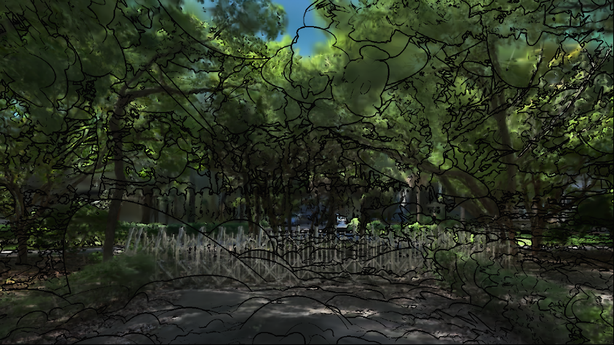
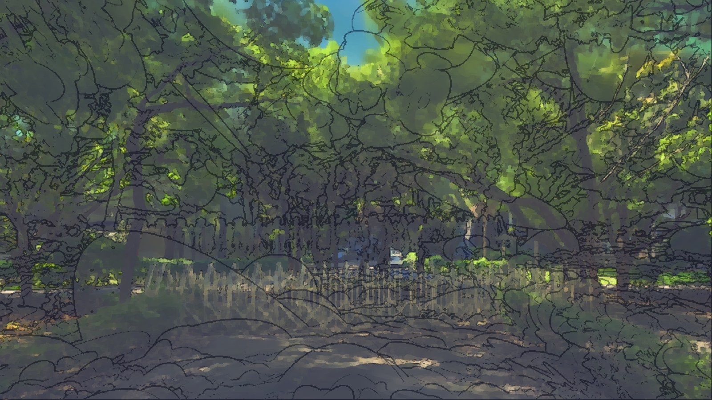
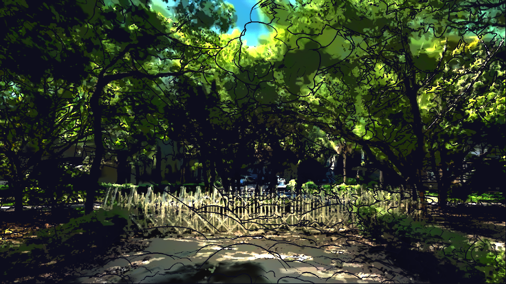
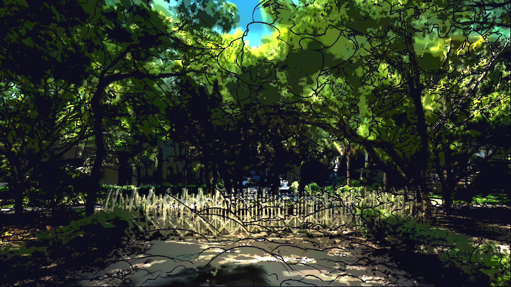
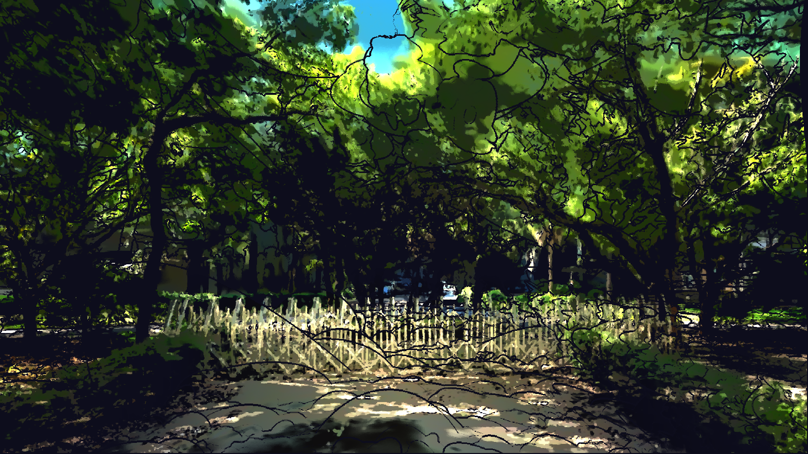
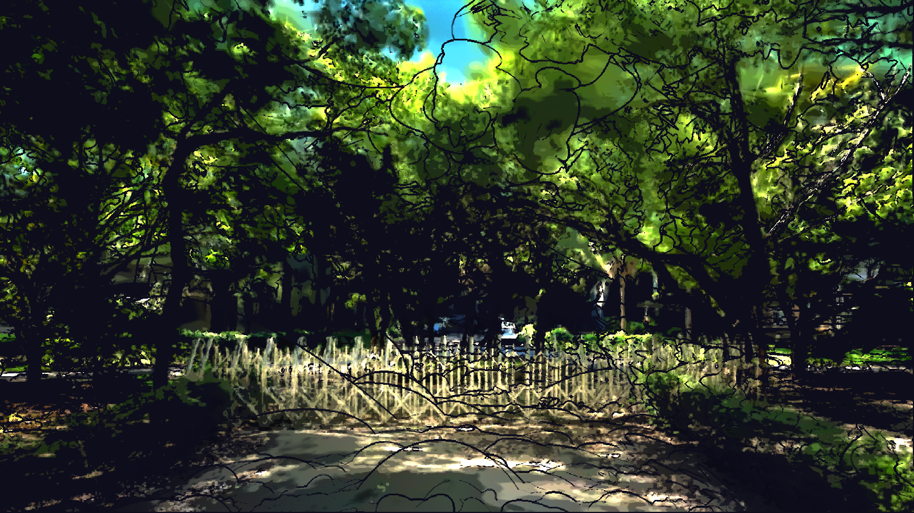
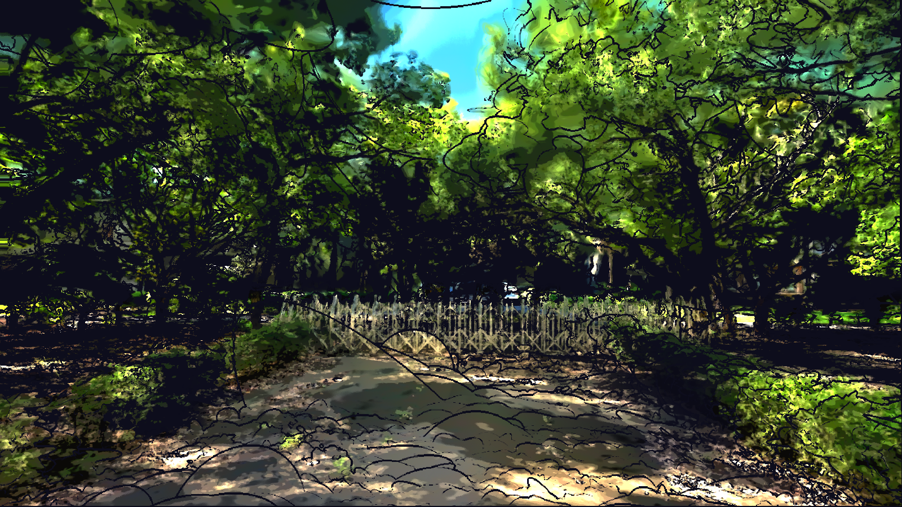

# 迭代紀錄

這個頁面記錄竹銘館 3DGS 掃描從原始畫面到最終成品的七個階段：每一步想解決什麼、怎麼做，以及當時的程式碼和畫面。

七張截圖都用同一個鏡頭、由各階段當時的腳本重新跑出來。第 4 到 6 階段的差別主要在動態，靜態畫面看起來會比較接近。

## 目錄

1. [畫出 outline](#stage-1)
2. [以莫內風格色塊化](#stage-2)
3. [細調色塊、對比、黑白點，加上康莊大道](#stage-3)
4. [依生命方向流動](#stage-4)
5. [加大到遊戲中可察覺的擺動](#stage-5)
6. [分開每棵樹，只動葉與灌木，模仿海邊陣風](#stage-6)
7. [陽光把手](#stage-7)

## 階段 1：畫出 outline

把一份 3D Gaussian Splatting 掃描當成畫布，第一步是讓它有線條。

原本的後製材質用深度做模糊和馬賽克。我們把這兩個 Custom 節點的 HLSL 換成輪廓線：比較每個像素和上下左右鄰居的深度差，再加上亮度差。掃描裡的樹葉邊緣很雜，只看深度抓不到，所以要兩者一起判斷。

**關鍵參數**：THICKNESS 1.5、DEPTH_THRESHOLD 0.03、COLOR_THRESHOLD 0.25

**程式碼**：[腳本 apply.py](stages/01_outline/apply.py) · [材質 material.hlsl](stages/01_outline/material.hlsl) · [全部參數 parameters.json](stages/01_outline/parameters.json) · [和上一階段的差異](stages/01_outline/README.md)

## 階段 2：以莫內風格色塊化

下一步是把照片感拿掉，讓畫面像顏料堆出來的。

用 Kuwahara 濾鏡把畫面變成邊緣清楚的色塊，不是方格馬賽克。陰影不用黑色，往藍紫色提亮；亮部帶暖黃，再混一點白做出粉彩感。輪廓線也改用比底色更深的顏料色，不再是黑墨線。

**關鍵參數**：PAINT_RADIUS 3、SATURATION 1.3、PASTEL 0.12、SHADOW_LIFT 0.18、LINE_STRENGTH 0.55

**程式碼**：[腳本 apply.py](stages/02_monet_patches/apply.py) · [材質 material.hlsl](stages/02_monet_patches/material.hlsl) · [全部參數 parameters.json](stages/02_monet_patches/parameters.json) · [和上一階段的差異](stages/02_monet_patches/README.md)

## 階段 3：細調色塊、對比、黑白點，加上康莊大道

上一步的畫面太灰，這一步是一連串的細調，把明暗拉開，並做出視覺主線。

拿掉暗部提亮，改用對比曲線和色階分層，讓暗部直接融進輪廓線的深藍紫色。之後依序：亮度 +10%、色塊縮小、黑點和對比各減 20%、色階 4 階到 6 階。中央道路加了用世界座標計算的暖色聚光，鏡頭移動時光會留在路上。

**關鍵參數**：CONTRAST 1.36、BANDS 6、PAINT_SCALE 0.4、DARK_LO/HI 0.08/0.224、BRIGHTNESS 1.1、ROAD_BOOST 1.1

**程式碼**：[腳本 apply.py](stages/03_tone_and_avenue/apply.py) · [材質 material.hlsl](stages/03_tone_and_avenue/material.hlsl) · [全部參數 parameters.json](stages/03_tone_and_avenue/parameters.json) · [和上一階段的差異](stages/03_tone_and_avenue/README.md)

## 階段 4：依生命方向流動

畫面開始動起來，方向不是隨機的，而是順著生命的脈絡。

讓色塊取樣的位置隨時間移動：貼近地面的泥土原地畫圈，樹幹和樹葉由下往上，用兩層交替淡入淡出來無縫循環。掃描沒有物件分類，所以用顏色和離地高度判斷；灰白黑的建築和鐵門不動。這個階段也加入了朝太陽方向的光束。

**關鍵參數**：FLOW_UP_SPEED 0.35、FLOW_UP_LENGTH 7.2、FLOW_CIRCLE_RADIUS 3.0、LEAF_SPEED 4.68、ALIVE_SAT (0.12, 0.25)、RAY_INTENSITY 2.2

**程式碼**：[腳本 apply.py](stages/04_life_flow/apply.py) · [材質 material.hlsl](stages/04_life_flow/material.hlsl) · [全部參數 parameters.json](stages/04_life_flow/parameters.json) · [和上一階段的差異](stages/04_life_flow/README.md)

## 階段 5：加大到遊戲中可察覺的擺動

幾個像素的晃動在遊戲裡看不出來，擺動要大到一眼就能注意到。

單純把數字調大會撕碎畫面，輪廓線也不會跟著動。所以改成在讀取任何東西之前就先移動取樣位置，讓顏色和線條一起擺；並用視線仰角和大範圍平滑的綠色遮罩，讓樹梢擺得大、地面不動。

**關鍵參數**：SWAY_AMOUNT 0.03（1600 寬畫面約 48 像素）、SWAY_ELEVATION (0.05, 0.35)

**程式碼**：[腳本 apply.py](stages/05_visible_sway/apply.py) · [材質 material.hlsl](stages/05_visible_sway/material.hlsl) · [全部參數 parameters.json](stages/05_visible_sway/parameters.json) · [和上一階段的差異](stages/05_visible_sway/README.md)

## 階段 6：分開每棵樹，只動葉與灌木，模仿海邊陣風

大幅度有了，但整片一起動像一塊布。這是最多次失敗的階段。

試過每棵樹各自頻率（還是像布）、葉簇亂數抖動（太扭曲）、葉子物理軌跡（葉子像融化）。最後有效的是想像海邊灌木叢：平時安靜，一陣風來整叢左右擺，再靜下來。每棵樹在陣風週期裡的時機被打散，所以同一時間只有部分的樹在擺。用點雲擬合的地形曲面排除貼地的草，並用偵測到的樹幹位置鎖住樹幹。

**關鍵參數**：SWAY_RHYTHM 2.6 秒、GUST_PERIOD 7 秒、TREE_GUST_SPREAD 0.7、TREE_SPEED 0.5、SHRUB_SCALE 0.5、TRUNK_RADIUS 90

**程式碼**：[腳本 apply.py](stages/06_natural_wind/apply.py) · [材質 material.hlsl](stages/06_natural_wind/material.hlsl) · [全部參數 parameters.json](stages/06_natural_wind/parameters.json) · [和上一階段的差異](stages/06_natural_wind/README.md)

## 階段 7：陽光把手

最後讓使用者自己調光線。

材質直接讀引擎的太陽方向和強度，所以轉動 SunHandle 就會即時更新。掃描不吃燈光，因此從點雲烘焙一張三層高度的遮光圖，讓地面點朝太陽穿過樹冠，算出柔和的光斑。第一版太亮太假，改回和康莊大道相同的提亮方式才寫實。編輯器選單「太陽把手」有時間、方位、亮度、暖色四條滑桿。低矮灌木也在這裡用點雲分布圖加入擺動。

**關鍵參數**：SUN_POOL 0.6、SUN_SOFTNESS 0.06、CANOPY_ABSORB 2.5、LOW_SHRUB_SWING 0.75

**程式碼**：[腳本 apply.py](stages/07_sun_handle/apply.py) · [材質 material.hlsl](stages/07_sun_handle/material.hlsl) · [全部參數 parameters.json](stages/07_sun_handle/parameters.json) · [和上一階段的差異](stages/07_sun_handle/README.md)

## 最終成品

- [最終版腳本](scripts/outline_3dgs_pp.py)
- [陽光把手面板](content_python/sun_panel.py)
- [遮光圖烘焙](scripts/bake_canopy.py) · [灌木分布圖烘焙](scripts/bake_low_shrubs.py)
- [完整專案下載](https://github.com/anniebelly/Unreal-Engine-Projects-at-NYCU-IAA/releases/tag/v1.0-zhuming-hall)
