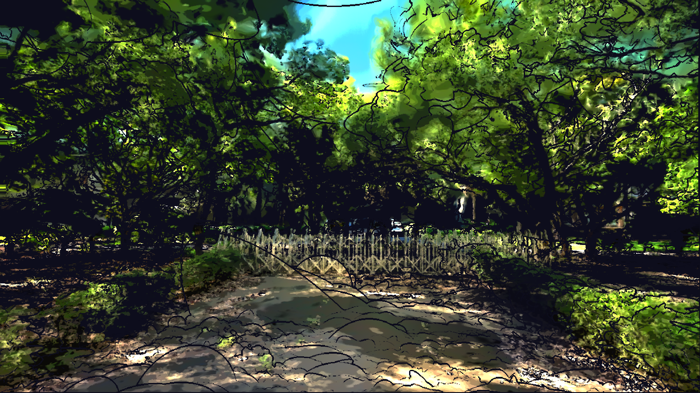

# ZhuMing 3DGS Stylize

在 Unreal Engine 5.6 裡，把 3D Gaussian Splatting 掃描（陽明交大博愛校區竹銘館後方）做成有輪廓線、色塊和自然風的風格化場景。所有效果都寫在一個後製材質裡，並用 Python 腳本產生。

## 七個迭代階段

完整的過程說明、截圖和程式碼連結見 **[迭代紀錄](ITERATIONS.md)**。

每個階段的資料夾都有截圖、全部參數（`parameters.json`）、和上一階段的差異（`README.md`）、可重現的腳本（`apply.py`），以及實際的材質程式碼（`material.hlsl`）。

| 階段 | 內容 |
|---|---|
| [1](stages/01_outline/) | 畫出 outline |
| [2](stages/02_monet_patches/) | 以莫內風格色塊化 |
| [3](stages/03_tone_and_avenue/) | 細調色塊大小、對比、黑白點，中央道路的康莊大道聚光 |
| [4](stages/04_life_flow/) | 依生命方向流動：地面畫圈，樹木由下往上 |
| [5](stages/05_visible_sway/) | 擺動幅度加大到遊戲中可察覺 |
| [6](stages/06_natural_wind/) | 分開每棵樹，只動樹葉和灌木，模仿海邊陣風 |
| [7](stages/07_sun_handle/) | 調整光線的 UI：陽光把手 |

## 專案規格

整個專案的設定都寫成了文字：[Markdown 總覽](project_spec/PROJECT.md)，以及同資料夾的 JSON（關卡物件、材質、參數、Config、資產清單）。

## 完整專案下載

到 [Releases](https://github.com/anniebelly/Unreal-Engine-Projects-at-NYCU-IAA/releases/tag/v1.0-zhuming-hall) 下載壓縮檔（約 1 GB），解壓後用 UE 5.6 打開 `Test_1006.uproject`，關卡為 `Lvl_ZhuMingHall`。

## 內容

- `scripts/outline_3dgs_pp.py`：最終版，所有參數都在檔案開頭
- `scripts/bake_canopy.py`、`scripts/bake_low_shrubs.py`：從 PLY 掃描產生遮光圖和灌木分布圖（用一般的 `python3` 執行）
- `scripts/face_gate_sun_handle.py`：開場視角
- `content_python/`：陽光把手面板，放到專案的 `Content/Python/`
- `data/`：烘焙好的兩張圖和樹幹位置

## 裝到自己的專案

只是想打開看成果的話，請用[專案首頁](../README.md)的下載連結。如果你已有這份竹銘館掃描，想把效果裝到自己的專案，需要：

- UE 5.6、NanoGS 和 Python Editor Script Plugin
- 掃描放在關卡裡，旋轉 0、縮放 1（位置不限）
- 課程材質 `/Game/_CMgit/_HLSL/CM_3DGS_PP`，`CustomBrick` 節點接到 Emissive Color，並掛在 PostProcessVolume 上
- 關卡裡有 DirectionalLight 和 SkyAtmosphere

步驟：

1. 把 `data/` 裡的檔案複製到專案的 `Saved/CMgit/`。
2. 把 `content_python/` 裡的檔案複製到專案的 `Content/Python/`，重開編輯器。
3. 打開關卡，在 Output Log 的 Python 模式執行 `exec(open("腳本路徑").read())`，腳本是 `scripts/outline_3dgs_pp.py`。

各階段的 `parameters.json` 是那個階段腳本開頭的設定值紀錄，不是 Post Process 的欄位，無法直接貼進 PostProcessVolume 或材質。要調整效果，請改 `apply.py`（或 `scripts/outline_3dgs_pp.py`）開頭同名的數值，再執行一次腳本，腳本會把它們寫進材質。

若要和原作相同的亮度和 Play 位置，再執行 `scripts/fix_exposure.py`（把曝光固定在 PostProcessVolume）和 `scripts/fix_play_start.py`（把玩家站的地面貼合掃描）。

康莊大道的光是從 PlayerStart 連到 `MatPreviewMesh`，沒有這個物件時會用預設座標，位置可能會偏。`GROUND_FIT`、遮光圖和樹幹位置都是這份掃描專屬的，換掃描要用 `bake_*.py` 重新產生。這個流程尚未在其他專案實測。

## 已知限制

- 樹葉的擺動是畫面扭曲，不是真的移動點雲。要真實的單片葉子運動，需要修改 NanoGS 的 C++。
- 掃描本身不吃燈光，光線是在後製裡重算的，掃描裡原有的光影會留著。
- 陽光把手只存在於編輯器，打包後的遊戲沒有。

## 致謝與授權

後製材質的基礎和 `_CMgit` 素材來自老師 CMHsieh（Computing Aesthetics Lab）。NanoGS 外掛、掃描資料和這些素材只在 Release 的壓縮檔裡，不在 repo 的檔案中。

本作品採用 [CC BY-NC 4.0](https://creativecommons.org/licenses/by-nc/4.0/deed.zh-hant) 授權（全文見 `LICENSE`）：可以自由使用、修改和分享，但要署名，且不得用於商業目的。此授權只涵蓋本 repo 中屬於作者的內容；CMHsieh 的原始素材、NanoGS 和 Unreal 範本內容不在授權範圍內。
