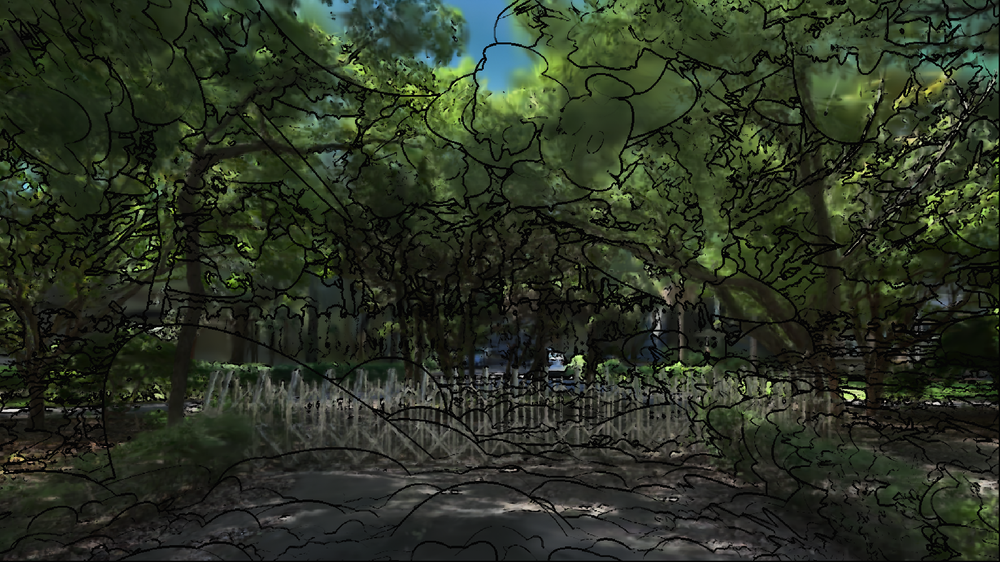

# 階段 1：畫出 outline

用深度差和亮度差找邊緣，在畫面上畫出線條。把材質原本的模糊和馬賽克換掉。

## 檔案

- `parameters.json`：這個階段的全部參數
- `apply.py`：套用這個階段的腳本，內含當時的完整設定
- `material.hlsl`：實際寫進材質 Custom 節點的程式碼

## 和上一階段的差異

這是第一個階段，全部參數見 `parameters.json`。
