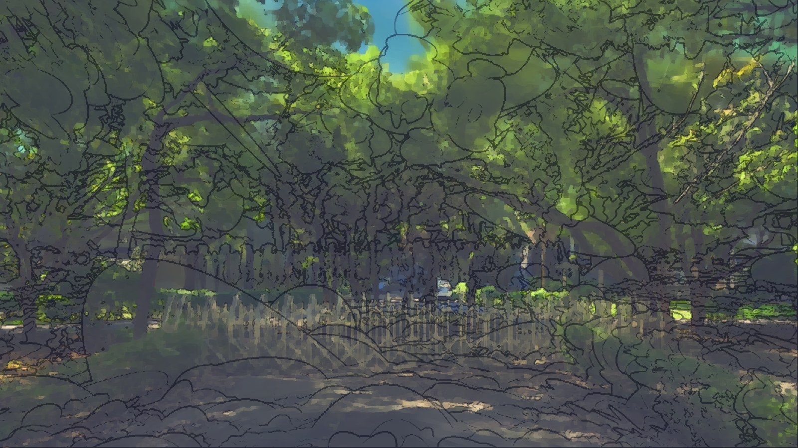

# 階段 2：莫內風格色塊化

加入 Kuwahara 濾鏡做出色塊筆觸，再加上有色的陰影、暖色高光和粉彩感，輪廓線改用顏料色。

## 檔案

- `parameters.json`：這個階段的全部參數
- `apply.py`：套用這個階段的腳本，內含當時的完整設定
- `material.hlsl`：實際寫進材質 Custom 節點的程式碼

## 和上一階段的差異

| 參數 | 上一階段 | 這個階段 |
|---|---|---|
| `MONET` | False | True |
