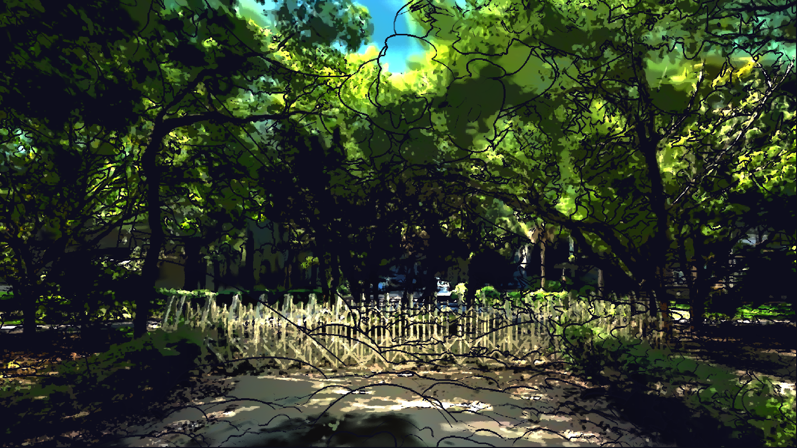

# 階段 3：細調色塊、對比、黑白點與康莊大道

色塊縮小，對比和暗部調整，暗部融入輪廓線，整體亮度 +10%，中央道路加上世界座標的聚光（康莊大道）。

## 檔案

- `parameters.json`：這個階段的全部參數
- `apply.py`：套用這個階段的腳本，內含當時的完整設定
- `material.hlsl`：實際寫進材質 Custom 節點的程式碼

## 和上一階段的差異

| 參數 | 上一階段 | 這個階段 |
|---|---|---|
| `PAINT_SCALE` | （新增） | 0.4 |
| `BRIGHTNESS` | （新增） | 1.1 |
| `SATURATION` | 1.3 | 1.4 |
| `CONTRAST` | （新增） | 1.36 |
| `PIVOT` | （新增） | 0.3 |
| `BANDS` | （新增） | 6 |
| `PASTEL` | 0.12 | 0.1 |
| `DARK_LO` | （新增） | 0.08 |
| `DARK_HI` | （新增） | 0.224 |
| `MONET_LINE_COLOR` | （新增） | (0.05, 0.05, 0.11) |
| `LINE_STRENGTH` | 0.55 | 1.0 |
| `HIGHLIGHT_BOOST` | （新增） | 0.4 |
| `ROAD` | （新增） | True |
| `ROAD_HALF_WIDTH` | （新增） | 170.0 |
| `ROAD_SOFT` | （新增） | 140.0 |
| `ROAD_HEIGHT` | （新增） | 120.0 |
| `ROAD_BOOST` | （新增） | 1.1 |
| `ROAD_TINT` | （新增） | (1.0, 0.94, 0.8) |
| `ROAD_A` | （新增） | (256.32, -72.11, -10.0) |
| `ROAD_B` | （新增） | (639.0, 249.0, -137.0) |

移除的參數：`SHADOW_TINT`、`SHADOW_LIFT`
