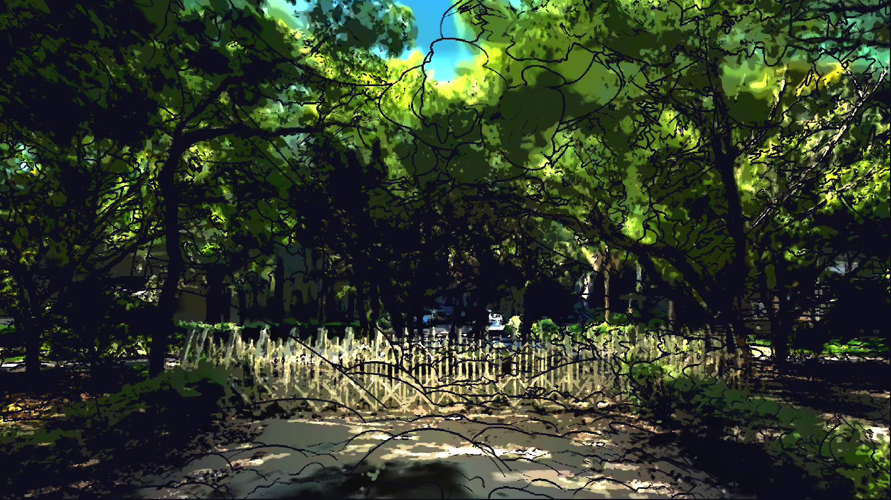

# 階段 4：生命流動方向

色塊依生命脈絡流動：地面原地畫圈，樹幹和樹葉由下往上，建築、鐵門等無生命物體不動。這個版本也含太陽方向的光束（god rays）。

## 檔案

- `parameters.json`：這個階段的全部參數
- `apply.py`：套用這個階段的腳本，內含當時的完整設定
- `material.hlsl`：實際寫進材質 Custom 節點的程式碼

## 和上一階段的差異

| 參數 | 上一階段 | 這個階段 |
|---|---|---|
| `FLOW` | （新增） | True |
| `FLOW_UP_SPEED` | （新增） | 0.35 |
| `LEAF_SPEED` | （新增） | 4.68 |
| `FLOW_UP_LENGTH` | （新增） | 7.2 |
| `FLOW_CIRCLE_SPEED` | （新增） | 1.2 |
| `FLOW_CIRCLE_RADIUS` | （新增） | 3.0 |
| `GROUND_HEIGHT` | （新增） | 50.0 |
| `ALIVE_SAT` | （新增） | (0.12, 0.25) |
| `RAYS` | （新增） | True |
| `RAY_SAMPLES` | （新增） | 48 |
| `RAY_LENGTH` | （新增） | 0.9 |
| `RAY_DECAY` | （新增） | 0.965 |
| `RAY_INTENSITY` | （新增） | 2.2 |
| `RAY_COLOR` | （新增） | (1.0, 0.9, 0.68) |
| `RAY_SKY_DEPTH` | （新增） | 3000.0 |
| `SUN_DIR` | （新增） | (0.0, 0.0, 1.0) |
