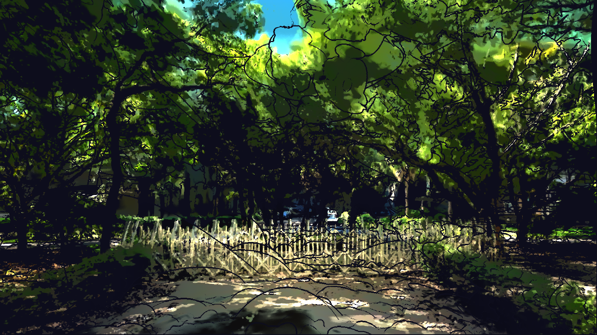

# 階段 5：加大到遊戲中可察覺的擺動

樹冠左右擺動加大到約 48 像素（1600 寬畫面），顏色和輪廓線一起擺。

## 檔案

- `parameters.json`：這個階段的全部參數
- `apply.py`：套用這個階段的腳本，內含當時的完整設定
- `material.hlsl`：實際寫進材質 Custom 節點的程式碼

## 和上一階段的差異

| 參數 | 上一階段 | 這個階段 |
|---|---|---|
| `SWAY` | （新增） | True |
| `SWAY_AMOUNT` | （新增） | 0.03 |
| `SWAY_SPEED` | （新增） | 1.2 |
| `SWAY_ELEVATION` | （新增） | (0.05, 0.35) |
| `SWAY_RADIUS` | （新增） | 0.04 |
