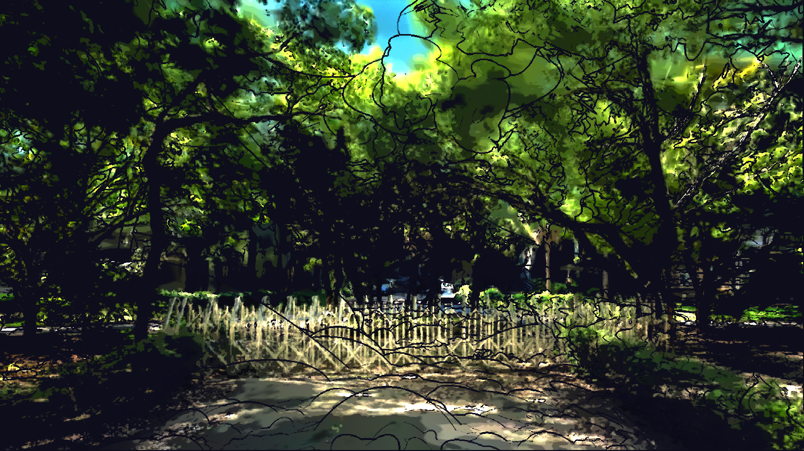

# 階段 6：分樹、只動葉與灌木、海邊陣風

不再整塊晃動。每棵樹有自己的節奏和陣風時機，只有樹葉和灌木動，樹幹、地面、圍欄、建築都固定。

## 檔案

- `parameters.json`：這個階段的全部參數
- `apply.py`：套用這個階段的腳本，內含當時的完整設定
- `material.hlsl`：實際寫進材質 Custom 節點的程式碼

## 和上一階段的差異

| 參數 | 上一階段 | 這個階段 |
|---|---|---|
| `PAINT_RADIUS` | 3 | 2 |
| `PAINT_SCALE` | 0.4 | 0.3 |
| `FLOW` | True | False |
| `SWAY_RHYTHM` | （新增） | 2.6 |
| `SWAY_RATE_SPREAD` | （新增） | 0.25 |
| `TREE_GUST_SPREAD` | （新增） | 0.7 |
| `GUST_PERIOD` | （新增） | 7.0 |
| `GUST_SHARPNESS` | （新增） | 3.0 |
| `SWAY_CALM` | （新增） | 0.12 |
| `GUST_SPEED` | （新增） | 400.0 |
| `PLANT_MIN_HEIGHT` | （新增） | 35.0 |
| `SHRUB_SCALE` | （新增） | 0.5 |
| `TREE_SPEED` | （新增） | 0.5 |
| `TRUNK_RADIUS` | （新增） | 90.0 |
| `SHRUB_TOP` | （新增） | 250.0 |
| `SHRUB_BEND_HEIGHT` | （新增） | 150.0 |
| `ROW_RIPPLE` | （新增） | 0.012 |
| `GROUND_FIT` | （新增） | (174.82, -72.22, -49.3, 11.34, 14.51, 5.02, -1.05, -1.46, -3.94, -1.19) |
| `LEAF_MASK_RADIUS` | （新增） | 0.032 |
| `LEAF_STREAM` | （新增） | 0.0 |
| `CROWN_RADIUS` | （新增） | 300.0 |
| `TREE_COUNT` | （新增） | 48 |
| `TREE_SPACING` | （新增） | 300.0 |
| `WIND_DIR` | （新增） | (0.8, 0.6) |
| `BANDS` | 6 | 12 |
| `TREE_LIST` | （新增） | [] |

移除的參數：`SWAY_SPEED`、`SWAY_ELEVATION`、`SWAY_RADIUS`
