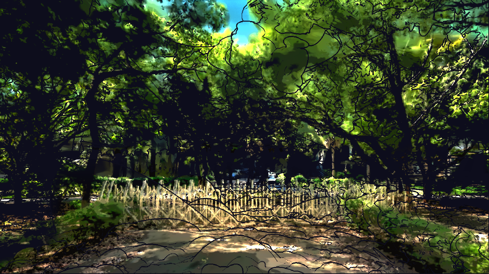

# 階段 7：陽光把手

SunHandle 即時驅動太陽方向、強度和顏色，並有滑桿面板（Content/Python/sun_panel.py）。也包含低矮灌木的擺動和開闊地面的柔和日光。

## 檔案

- `parameters.json`：這個階段的全部參數
- `apply.py`：套用這個階段的腳本，內含當時的完整設定
- `material.hlsl`：實際寫進材質 Custom 節點的程式碼

## 和上一階段的差異

| 參數 | 上一階段 | 這個階段 |
|---|---|---|
| `LOW_SHRUB_SWING` | （新增） | 0.75 |
| `SUN` | （新增） | True |
| `SUN_NOON_PITCH` | （新增） | -78.0 |
| `SUN_POOL` | （新增） | 0.6 |
| `SUN_SOFTNESS` | （新增） | 0.06 |
| `CANOPY_ABSORB` | （新增） | 2.5 |
| `SUN_MAP_MIN` | （新增） | -3200.0 |
| `SUN_MAP_SPAN` | （新增） | 8000.0 |
| `SUN_BANDS` | （新增） | (425.0, 800.0, 1400.0) |

移除的參數：`SUN_DIR`
